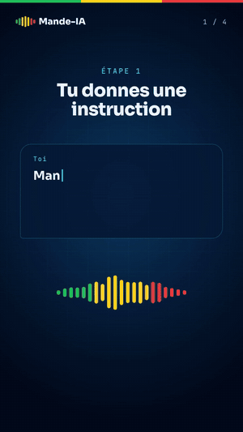

<!-- Professor-minta/Professor-minta README — GitHub Profile -->

# 👋 Issa Minta — Professeur

**Ingénieur Full-Stack IA autodidacte du Mali 🇲🇱**

*Créateur de **Mande-IA** · Fondateur de **Minta Services** & **Minta Academy***

Self-taught full-stack AI engineer from Mali, building Mande-IA, an AI assistant that speaks Bambara, French and English.

 

Mande-IA et ses agents, en 30 secondes

---

### 🔥 Ce que je construis

| Projet | Description | Stack |
|--------|-------------|-------|
| 🤖 **[Mande-IA](https://ia.mintaservices.com)** | IA trilingue Bambara · Français · Anglais, sur le web et sur [WhatsApp](https://wa.me/22392275884) · appel vocal en direct · photos et PDF · mode scène avec 10 agents spécialistes · [code source](https://github.com/Professor-minta/Mande-IA) | Node.js · Claude · Gemini · OpenAI Realtime · WhatsApp Cloud API |
| 🦙 **[Mande-IA v3 hors ligne](https://ollama.com/professor-minta/mande-ia.v3)** | Le modèle qui tourne sans internet, sur un simple ordinateur : `ollama run professor-minta/mande-ia.v3` · Built with Llama | Llama 3.2 3B · Ollama · Open WebUI |
| 🎓 **[Minta Academy](https://mintaservices.com/academy/)** | Cours gratuits · 10 modules : cloud, VPS, IA locale · [code source](https://github.com/Professor-minta/Minta-Academy) | Markdown · HTML · Nginx |
| 📊 **[Data-Collections](https://data.mintaservices.com)** | Collecte de voix et de textes en bambara, validée par la communauté · [code source](https://github.com/Professor-minta/Mande-IA/tree/main/data-collections) | Node.js · SQLite · Express |
| 🚀 **[Entrepreneuriat](https://mintaservices.com/entrepreneuriat/)** | Accompagnement des jeunes entrepreneurs maliens, de l'idée au premier client | Community · WhatsApp |

---

### 🌱 En ce moment

🧠 Entraîner **Mande-IA v5** avec les voix et les phrases bambara de Data-Collections 
🎓 Lancer la **première promotion de Minta Academy à Bamako** : 12 séances, 15 places 
💳 Ouvrir **Mande-IA Pro** au paiement par Orange Money et Moov Money

---

### 🤝 Contribuer

Tu parles bambara ? Lis quelques phrases à voix haute sur **[data.mintaservices.com](https://data.mintaservices.com)** : chaque voix validée apprend à Mande-IA. 
Une ⭐ sur [Mande-IA](https://github.com/Professor-minta/Mande-IA) aide le projet à être vu.

---

### 🛠️ Stack

 

---

### 📬 Me contacter

📧 contact@mintaservices.com &nbsp;|&nbsp; 📱 +223 77 29 52 59 &nbsp;|&nbsp; 📍 Missira, Ségou, Mali 🇲🇱

*Inspirer · Innover · Autonomiser la Jeunesse Malienne*

